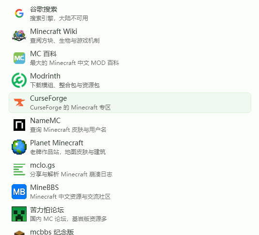
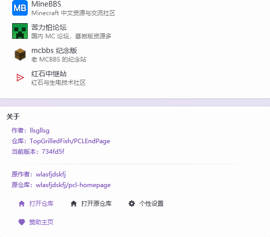

## PCL2 主页预设

这是 PCL2 主页预设的公开仓库

访问地址 'https://end.g-fish.dpdns.org'

原作者 wlasfjdskfj

本改版删去了大部分无用功能。


**功能介绍**

欢迎部分

1. 日期
2. 必应一图
3. 节日提醒
4. 每日一言
5. 天气预报
6. 4 个功能模块

功能网站

1. 将功能完整挪到了主页面外侧
2. 图标进行缓存



**新加特色功能**

1. 添加 AI 故障分析
   - 每小时可免费使用 3 次，模型走 DeepSeek Flash
   - 可以填写自己的密钥无限使用
2. 小工具
   - 一些玩 MC 可能会用到的计算器
3. 个性化设置
   - 支持切换单位
   - 支持切换语言
   - 支持切换色块浓度
   - 支持导出个性化码



**使用方法**

1. 打开 PCL2
2. 依次点击 设置 -> 个性化 -> 主页
3. 在「预设」里找本主页；找不到就选「联网更新」，下载地址填 https://end.g-fish.dpdns.org
4. 回到启动页，完成

**本地使用**

Python>=3.10

```
git clone https://github.com/TopGrilledFish/PCLEndPage.git
cd PCLEndPage
python run.py
```

默认地址 127.0.0.1:8787  
配置默认在config.json
每次修改需要重新运行`python -m pclhome generate`  
自检`python -m pclhome doctor --offline`  
如需公网部署只需放出Custom.xaml与static/  

**鸣谢**

- PCL 启动器作者 龙腾猫跃
- 原作者 wlasfjdskfj

**许可**

MIT
上游是 https://github.com/wlasfjdskfj/pcl-homepage  
请遵守MIT许可证  

欢迎 Fork，有问题可以去我主页找联系方式。
